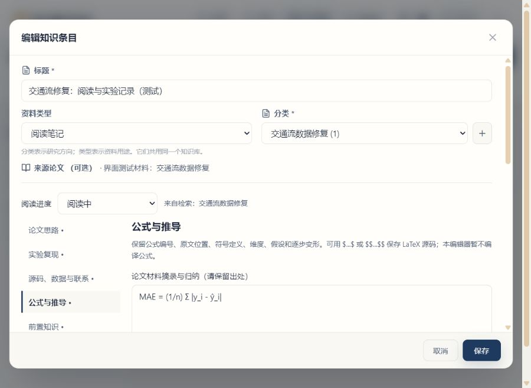

# ScholarNova 产品与使用手册

更新日期：2026 年 10 月 13 日。本手册说明当前源码中的第一阶段研究学习流程；已安装应用是否包含这些功能，请以实际安装版本为准。源码更新不会自动升级安装包。

ScholarNova 把找论文、阅读整理、知识积累和研究规划放在同一个桌面工作台里。比较合适的用法是：带着一个具体问题找到材料，边读边记录，把反复用到的知识与操作方法留下来，再让助手依据这些材料帮助比较和规划。它不是替你完成实验、证明创新性或自动投稿的系统。

本阶段不增加一套独立的学习导航，仍然使用“搜索”“知识库”“智能体”和已有研究路线入口。下面按一次真实研究的顺序介绍。想进一步理解底层技术，可另读[项目大白话与开发学习手册](PROJECT_EXPLAINED.zh-CN.md)；该文档是开发学习资料，部分版本说明较早，当前操作以本手册和界面为准。

下面是 1.2.12 的实际界面，内容为隔离测试环境中的示例记录。左图展示资料类型筛选，右图展示笔记章节与公式记录，点击图片可放大查看。

<table>
<tr>
<td width="50%" valign="top"><strong>按用途找回资料</strong> </td>
<td width="50%" valign="top"><strong>按章节持续整理</strong> </td>
</tr>
</table>

## 1. 先准备好模型和材料

打开“设置”，填写自己的模型服务地址、API Key 和该平台实际可用的模型名称，测试后保存。千问、GLM 等是模型，硅基流动、百炼等是提供调用服务的平台；名称相似不表示不同平台的 Key 和模型 ID 可以混用。具体入口见 [API 配置说明](API_PROVIDERS.md)。

阅读笔记中的“生成本节草稿”使用任务配置里的“分析”模型。可以为分析、智能体、视觉和出图分别选择适合的模型，不需要为了换厂商重写笔记。检查任务配置时，也要看是否启用了备用模型：一次点击整理一个章节，但主模型失败后可能按配置尝试备用模型，并不保证只有一次上游请求。

普通关键词检索、手写笔记、知识分类和 Markdown 导出不要求调用大语言模型。学术数据源仍可能有自己的 Key、额度、限流和网络要求。云端分析会把本次所需的问题与材料节选发给所选提供商；未公开论文、合作项目资料或其他敏感材料，应先确认允许这样使用。

全文来源有两种常见情况：应用找到可用的开放全文，或你在论文详情中上传自己有权使用的 PDF。图书馆门户目前用于跳转检索；学校账号登录、校园网或学校认可的 VPN 由你完成，不会自动绕过访问权限。上传或获取全文后，先看解析和覆盖范围提示，再开始依赖全文的操作。

## 2. 找论文：先限定问题，再限定时间

### 2.1 关键词与规划方式

建议把研究对象、任务和方法分开表达。例如，先搜“交通流 缺失数据 修复”，再搜“large language model traffic data imputation”，最后用“Qwen”“DeepSeek”等具体模型词缩小范围。只搜“大模型”通常范围过宽；一开始就把模型名称限定得很死，又可能漏掉采用其他方法但值得比较的论文。

搜索规划提供三种方式：

| 方式 | 适合什么时候用 | 模型调用边界 |
| --- | --- | --- |
| 自动 | 日常检索 | 短主题通常直接走规则，明确复杂的问题才使用模型规划 |
| 快速检索 | 已经知道关键词，想尽快看结果 | 不调用查询规划模型；不代表所有数据源都免费 |
| AI 规划 | 希望拆解复杂条件或研究问题 | 规划模型约 20 秒预算，失败后转规则检索；不是整次搜索的总时限 |

同一关键词可以再次搜索，也可以更换规划方式或年份后重新搜索。注意各来源的返回数量和状态：某个来源限流时，其他来源的结果不等于它的完整替代；没有结果也不等于没有相关论文。

### 2.2 “今年至今”到底覆盖到哪一天

年份选项会传到数据源检索条件，不只是筛掉屏幕上已经返回的几十篇论文。

| 界面选项 | 时间范围 | 以 2026 年 10 月 13 日为例 |
| --- | --- | --- |
| 全部年份 | 不额外限制年份 | 用于补经典工作、基线方法和研究脉络 |
| 今年至今 | 当年 1 月 1 日至本机今天 | 2026-01-01 至 2026-10-13 |
| 近三年至今 | 本年与前两个自然年，截止今天 | 2024-01-01 至 2026-10-13，并非滚动 36 个月 |
| 自定义年份 | 起始年年初至结束年年末；结束年是今年时截止今天 | 2023—2025 表示三个完整自然年 |

自定义结束年份不能超过今年，开始年份不能晚于结束年份。日期依据电脑本地日历，请先确保系统日期正确。

结果中的“本次检索时间”表示这次检索何时开始，**不是数据源刚刚更新索引的时间**。OpenAlex、Crossref、Semantic Scholar 等收录节奏不同；来源数据和服务缓存也可能有延迟，重复点击搜索不保证立刻看到刚发表的文章。日期条件能表达“检索这个时段内各源已收录的文献”，不能保证“截至今天全世界所有文献都已齐全”。

还需要区分三种日期：

- 期刊文章通常按来源提供的发表日期筛选，网络首发和正式刊载可能不同；不要把元数据入库日期当发表日期。
- arXiv 使用预印本提交日期条件，不等同于期刊发表日期，也不是最后修订日期。
- 只有年份、没有完整日期的记录只能做年粒度判断。界面会提示这种不精确性，无法据此确认文章是在本月还是本周发表。

**新近发表不等于更有创新性。** 时间筛选解决“新不新”，创新判断还需要比较它改变了什么、证据是否充分、相对于哪些基线有价值。引用量、相关度和推荐分也不能单独证明创新性。

### 2.3 补找相似文献与写作参考

在论文详情的“相似论文”中，可以选择研究内容相近、摘要结构参考或同刊相似论文。它们用于扩大阅读范围：摘要结构相似只是可观察到的写作线索，不表示全文结构相同；同刊也不表示研究方法相同。

查看频次时要看样本范围和分母。界面统计的是本次检索候选中的词语或模型名称出现情况，不是某期刊全部论文的使用率，更不是整个学科的市场占比。

## 3. 从搜索结果开始一份阅读笔记

1. 在搜索页“笔记研究分类”中选择或输入方向，例如“交通流数据修复”。这一步确定笔记准备放在哪里，不会把这个分类名称当成学术检索条件。
2. 打开一篇论文，核对标题、摘要、年份和来源；需要看全文时，先处理全文获取或 PDF 导入。
3. 点击“阅读笔记 / 继续编辑”。已在所选分类保存过这篇论文的阅读笔记时，继续编辑既有记录；没有时打开新笔记表单。
4. 核对标题、分类和来源论文，填写内容并点击保存。看到保存成功后，这份笔记才成为知识库中的长期资料。
5. 下次从“知识库”按分类、类型或标题找回笔记；也可以在搜索页选择同一分类，从同一篇论文继续编辑。

同一篇论文可以服务不同研究方向。请在打开笔记前明确分类，避免把“交通预测”和“数据修复”的思考混在一起；如果改动了笔记分类，之后应按改后的分类寻找。分类是应用内的组织方式，不会自动在电脑磁盘上建立文件夹，也不会自动改变 Zotero 集合。

没有指定分类时，按“未分类”查找或新建，不会取其他研究分类的同篇笔记来续写。只想先收藏、稍后整理时可以使用这个默认值；开始正式研究后再选择清楚的方向名称。

搜索页的分类选择与本轮结果、临时分析共用当前页面的工作上下文，离开页面后不作为永久偏好保存。**临时搜索清理不等于删除已保存笔记**。未保存的编辑内容仍需先保存，不能依靠搜索缓存或关闭弹窗来保存草稿。

## 4. 知识库中的三种研究记录

| 类型 | 主要用途 | 合适的内容 |
| --- | --- | --- |
| 阅读笔记 | 围绕一篇论文记录阅读和实践过程 | 原文摘录、方法理解、公式、复现计划、实际日志与待查问题 |
| 基础知识卡 | 把跨论文反复用到的概念讲清楚 | 定义、前提、推导、例子、学习资料和自测题 |
| 技能卡 | 留下能够再次使用的操作方法 | 输入输出、依赖环境、操作步骤、命令、失败排查和验收办法 |

已有普通知识条目继续保留，不需要一次性搬家。知识库上方可以切换阅读笔记、基础知识或技能卡，结合左侧分类与搜索框定位内容。类型回答“这是什么记录”，分类回答“它属于哪个研究方向”。

阅读进度可选择待阅读、阅读中、复现中或已整理。它是你对自己的进度标记，不代表系统已验证掌握程度，也不代表实验运行成功。通常先把一篇论文读懂，再决定哪些实验值得花时间复现，不必为了填满表单一次完成所有章节。

## 5. 九个章节分别写什么

| 章节 | 建议首先记录 | 可以让 AI 协助的部分 |
| --- | --- | --- |
| 论文思路 | 研究问题、已有方法、本文改动、支持证据、局限与自己的疑问 | 按当前材料梳理论证关系，列出尚缺的证据 |
| 实验复现 | 环境版本、硬件、数据划分、预处理、基线、参数、随机种子、运行命令、指标与实际日志 | 从材料提取已报告的设置，区分已知条件和待补信息，形成待执行清单 |
| 源码、数据与联系 | 材料中实际出现的代码链接、数据链接、公开邮箱及出处 | 此章使用本地字符串提取，不调用模型，不猜地址 |
| 公式与推导 | 公式编号、原文位置、符号与维度、假设、逐步变形、自己卡住的位置 | 解释材料支持的公式线索，给出学习建议；缺失公式不补造 |
| 前置知识 | 概念是什么、本文哪里用到、资料、最小练习、自己是否理解 | 组织学习顺序和待补概念，之后提炼为基础知识卡 |
| 论文写作与伪代码 | 各章节的论证任务；算法输入、输出、步骤与停止条件 | 给出结构或伪代码草稿，区分论文已做工作与自己的计划 |
| 数据图与结构图 | 真实数据、单位、样本与误差；模块、输入输出与连线含义 | 梳理绘图所需数据和图示表达方式；本节不直接生成图片 |
| 中英术语与表达 | 术语对照、原句与改写、变量名、指标、引用和语气强度 | 给出表达建议，避免把“可能”改成“证明” |
| LaTeX 与 Word 排版 | 目标模板、标题层级、题注、交叉引用、参考文献与已遇到的问题 | 整理排版步骤和检查清单；不在本节编译或导出排版文件 |

公式可以使用 `$...$` 或 `$$...$$` 保存 LaTeX 源码，本编辑器当前不编译它。图表、伪代码、双语写作与排版章节提供的是可编辑建议和个人记录，不是新增加的自动制图、代码执行或投稿系统。需要研究路线图、架构图时，复用已有研究路线中的制图功能。

### 5.1 每章分开保留三类内容

- **论文材料摘录与归纳**：放原文摘录、出处以及你的材料整理。自己的归纳仍要对照原文，不会因为写在这一栏就自动成为已验证事实。
- **AI 建议**：放生成的解释、计划或写作建议。保留材料范围和来源快照，不要直接改标成作者的结论。
- **我的想法与实际操作记录**：写赞同与存疑之处、自己的假设、修改方案、真实命令、日志和实测结果。

例如，论文报告的误差值应放材料栏，并注明表格或段落；“尝试更高缺失率”放 AI 建议或个人计划；自己跑出的结果放实际操作记录，同时写数据划分和实验条件。这样回看时就不会混淆原论文、模型建议和自己的成果。

每个章节的每一栏上限为 20,000 个字符，不是整份笔记共用 20,000。追加草稿时，来源快照也占用长度；合并后超限会提示精简或导出，不会默默截掉已经手写的内容。较长的实验日志适合单独保留文件，在笔记中记录路径、关键结果和对应实验编号。

### 5.2 按需生成一章，确认后再保存

1. 切换到需要整理的章节，展开“依据论文材料辅助整理本节”。
2. 可选填写“本节重点”，例如“请检查复现还缺哪些数据划分与随机种子信息”；该输入最多 2,000 个字符。
3. 点击“生成本节草稿”。系统只取这篇论文在本地已保存的摘要或缓存全文节选，不会因为点了这个按钮而自动下载 PDF、搜索代码仓库或执行程序。
4. 阅读“材料范围”、模型信息、警告和来源快照。只有摘要时，就把回答当成摘要级理解；有全文节选时，也不表示全文逐页都读完了。
5. 草稿完成后人工核对，点击“确认追加到 AI 建议栏”，需要时继续修改。
6. 最后点击笔记表单的保存。**草稿返回、追加进编辑框、成功保存是三个不同步骤。**

这条章节辅助路径目前只发送文字节选，不读取论文页面图像。论文详情中的图文分析是另一条已有功能，会单独显示实际送入的图表页；不要把两者的材料覆盖范围混为一谈。

来源快照保存当时引用的片段及标识，便于之后对照。显示的页码可能是章节起始页，不是某句话或公式所在的精确页码；`[S1]` 等编号属于该次草稿的材料，不应拿去对应另一轮回答的同名编号。来源编号通过检查，也不等于解释、推导或结论已经核实。

AI 超时、限流或基本引用检查未通过时，会说明本节草稿没有完成，不能把失败状态当成分析成功。已经写在当前编辑器里的内容不被覆盖，可以继续手写或稍后重试。离开前仍需保存；“停止等待”也不保证服务商没有接收请求或不会计费。模型用量未返回时，显示 0 不代表免费；“源码、数据与联系”的本地提取才明确没有模型调用。

### 5.3 源码、数据和作者联系怎么处理

在“源码、数据与联系”中点击“提取材料中的资源”，系统从本次选中的本地片段中查找可见的 HTTP(S) 链接和公开邮箱，同时保留附近文字和出处。确认后追加到论文材料栏，再保存笔记。

提取到的地址只是资源线索：材料里出现不等于官方仓库，不等于现在能打开，也不等于你获得了数据或代码的使用许可。请自己核对论文、项目主页、版本和许可后再下载。没有提取到，也可能只是当前摘要或节选没有包含资源说明，不应据此判断作者没有公开。

联系作者前，先确认邮箱确实属于论文中的联系信息，写清论文标题、想解决的具体问题与已经尝试的步骤。应用不会自动发邮件，也不会根据姓名猜私人邮箱。

## 6. 从“读过一篇”变成“学会一类”

阅读笔记保存后，打开知识详情，可以选择“提炼基础知识”或“提炼技能卡”。

- 基础知识提炼读取“前置知识”“公式与推导”中的已有记录。
- 技能卡提炼读取“实验复现”“数据图与结构图”“论文写作与伪代码”“LaTeX 与 Word 排版”中的已有记录。

这里的“提炼”先把相关记录带入新卡片表单，并保留来源论文和原笔记信息，**不是另一次 AI 总结，也不会自动保存**。你需要删掉只适用于该论文的杂项，补上适用条件，再保存为可复用的卡片；没有相关章节记录时，先回原笔记填写。

一张“缺失掩码与评估指标”基础知识卡，可以解释概念、计算例子和易错点；一张“交通数据修复实验检查表”技能卡，可以记录环境、数据划分、缺失机制、基线和验收方式。它们都可以与原笔记放在同一研究分类，之后供自己查找和助手检索。

卡片中的“使用 AI 压缩正文”是可选操作，会把正文替换为短摘要，不适合需要保留完整步骤的长记录。阅读笔记不会自动走这个压缩流程。

点击“导出 Markdown”可得到 `.md` 文本，包含正文、分类、来源论文信息和个人备注。它适合归档、版本管理或继续编辑，但不是数据库完整备份，不包含所有 PDF、图片和应用设置，也不是原生 Word/PDF 导出。

## 7. 用现有智能体和研究路线继续研究

到“智能体”建立一个独立对话，选择当前研究分类，再问具体问题，例如：“比较这个分类中的方法分别依赖哪些数据条件，哪些设置仍未核实？”

对话文件夹负责整理聊天，资料分类负责限制查找哪些知识，二者不是同一个开关。指定知识分类时，不会为了凑答案自动退回全库；本轮资料分类也不包含 Zotero。找不到足够材料时，应先补笔记或调整范围。基础知识卡、技能卡和个人设想仍保留各自的来源性质，不应把它们全当成已发表结论。

需要做路线规划时，在知识库进入已有的研究分析入口，选择相关条目，填写目标和约束。先审阅分析，再明确保存为研究路线；之后可使用路线、架构图等已有工具。比如限定“只使用已确认能取得的数据；先做两个基线；新方法先列假设，不填写未测出的提升数字”。

这里的 RAG，可以简单理解成“先找你保存的相关材料，再把材料交给模型回答”。它能减少没有依据的泛泛回答，但不是把模型变成事实校验器；来源范围、片段遗漏、个人记录准确性和模型理解都会影响结果。关键公式、数字与结论仍需回到原文或自己的实验记录核对。

## 8. 完整示例：交通流缺失数据修复

以下是一套操作案例，不预设会命中哪篇论文，也不虚构实验结果。建议先选一篇能拿到材料的论文，把流程走通，再批量扩展。

1. **建方向**：在搜索页把“笔记研究分类”设为“交通流数据修复”。
2. **找近期工作**：选“近三年至今”，先搜“交通流 缺失数据 修复”。打开少量结果，确认它们研究的是补全缺失观测，而不只是预测未来值。
3. **补模型相关工作**：分别搜“Qwen traffic data imputation”“DeepSeek traffic data imputation”及更宽的“large language model traffic data imputation”。结果少时，回到任务和数据领域，不把未命中解释成研究空白。
4. **补基线**：改为“全部年份”，找传统插补、矩阵方法或时空模型等可比较工作。近期方法需要合适的基线，而不只是与近期论文相互比较。
5. **建笔记**：选定一篇，核对原文来源，按需导入有权使用的 PDF，点击“阅读笔记 / 继续编辑”。先在“论文思路”写清输入、输出、缺失场景、主要改进与证据。
6. **查资源**：在“源码、数据与联系”提取当前材料线索，人工确认仓库、数据版本和许可。没找到就记为待查，不让模型猜仓库地址。
7. **列复现条件**：在“实验复现”记录数据划分、随机缺失或连续缺失、掩码生成、缺失率、预处理、指标、硬件和种子。不明确的地方写“材料未说明，待核实”。
8. **补基础**：在“公式与推导”说明张量每个维度、掩码的含义与损失计算范围，在“前置知识”记录自己不熟悉的概念。必要时只生成这一章的辅助草稿。
9. **自己运行实验**：在独立、可控的开发环境中检查代码后运行，把实际命令、日志与结果写入个人操作记录。尚未运行的实验保持为计划，不填推测数字。
10. **形成积累**：保存笔记，提炼基础知识卡和复现实验技能卡，导出一份 Markdown。到智能体选择“交通流数据修复”，比较已保存方法；需要进一步研究时再保存为研究路线。

可以直接使用的“本节重点”示例：

> 只依据当前材料，列出交通流缺失数据修复的输入、输出、缺失机制、数据划分、基线与评估指标。将材料明确说明的条件、材料未说明的条件、供我考虑的复现实验建议分开，不补造参数或结果。

完成后，最有价值的产物不是一段漂亮摘要，而是：知道论文解决什么、知道还缺哪些复现条件、能找到自己的记录，并能分清作者做过什么和自己准备做什么。

## 9. 自己验收一遍是否好用

下面是操作检查表，不是宣称已经替你的电脑或数据完成了测试。先用一篇公开论文或你有权使用的材料验证，再处理正式研究资料。

| 检查 | 操作 | 应看到的结果 |
| --- | --- | --- |
| 时间条件 | 搜同一主题，分别选全部、今年、近三年、自定义年份 | 本次检索显示对应日期范围和检索时间；非法范围不能提交 |
| 重新检索 | 同词再次搜索，或换年份后搜索 | 新一轮有明确进度与来源状态，不是按钮无响应 |
| 分类续写 | 在明确分类下保存阅读笔记，再从同篇论文、同分类打开 | 找回原记录；手写内容与来源关联仍在 |
| 研究方向隔离 | 换另一个分类，为同篇论文记录不同问题 | 两个研究方向各有记录，不互相覆盖 |
| 章节与进度 | 写两个章节、改变进度并保存，去知识库重开 | 章节、三类内容与个人进度都保留 |
| AI 按需 | 只生成一个章节，先不确认，再确认追加 | 未确认不改笔记；追加不覆盖手写；最终仍需保存 |
| AI 失败 | 遇到模型报错或超时后回看手写内容 | 显示未完成原因，原编辑内容不被清空，可继续保存 |
| 资源线索 | 用确有链接的材料执行资源提取 | 显示原字符串和出处，明确未联网核验、无模型调用 |
| 知识再利用 | 从有记录的相关章节提炼基础知识或技能卡 | 打开可编辑新卡片，保留来源，确认保存后才入库 |
| 导出 | 导出已保存笔记，使用文本编辑器打开 | 能看到中文内容、分类、来源和个人记录 |
| 清理范围 | 保存后离开搜索再返回，并去知识库查找 | 搜索临时结果清理；保存过的笔记仍可找回 |
| 资料问答 | 智能体选择目标分类提问 | 工具和来源对应所选范围；材料不足明确提示 |

模型是否真正完成，要看返回状态、模型标识、内容与来源，不能只看按钮结束转圈。资源提取无需模型；其他模型任务没有返回用量时，也不能据此断言没有调用或没有费用。

## 10. 保存、隐私与常见问题

**哪些只是暂存？** 搜索页的结果、临时分析、笔记分类选择，以及尚未保存的表单改动。保存成功的知识条目、阅读笔记、卡片、对话和研究路线另行持久保存。相同搜索期间切换论文可保留临时分析，但开始新搜索或离开搜索页会清理这部分界面缓存；这不表示服务端下载缓存或用户数据目录同时被删除。

**AI 为什么只说“摘要材料”？** 本地没有可用于该请求的全文片段，或者本轮只选中了摘要。先检查全文导入/解析状态。生成章节草稿本身不负责下载全文，短摘要也不能凭空提供实验细节。

**为什么资源提取没有找到代码？** 链接可能不在当前节选里、以图片形式出现或采用无法直接识别的写法。回原文查看资源说明、脚注和补充材料；不要让模型补造。

**为什么不能直接执行复现或导出 Word？** 第一阶段先把材料、建议和自己的工作记录管理好。执行外部代码涉及环境、依赖、权限和成本；原生文档生成涉及模板、公式和交叉引用。本阶段没有把这些尚未验收的能力包装成一键功能。

**网络或代理会影响使用吗？** 会影响外部学术源、全文网站与云模型，手工编辑本地笔记不依赖这些外网服务。本机服务的 `localhost`、`127.0.0.1` 不应误走外部代理。429 通常表示服务商限流或额度相关拒绝；不要连续狂点重试，先看具体提示、额度和模型权限。

**如何备份？** 退出应用后复制完整用户数据目录：Windows 通常为 `%APPDATA%/scholarnova-desktop`，macOS 为 `~/Library/Application Support/scholarnova-desktop`。Markdown 导出是单条文本备份，不能替代这个目录。备份可能包含模型 Key 和私有论文，应放在受保护的位置；当前配置不是系统钥匙串加密存储。

## 11. 本阶段与后续方向

| 现在可以使用 | 后续可逐步完善，但本阶段不承诺已有 |
| --- | --- |
| 来源级时间范围、当前来源状态与检索时间说明 | 持续订阅新文献、跨来源覆盖率与索引延迟监测 |
| 分类阅读笔记、九章记录、按需章节草稿 | 跨论文自动构建学习路线、长期掌握度与间隔复习 |
| 本地可见资源和公开邮箱线索提取 | 逐站点资源校验、版本与许可确认后的受控获取 |
| 复现计划与实际操作日志分开记录 | 隔离实验环境、明确授权后的执行、成本和资源监控 |
| 公式源码、推导过程与疑问记录 | 公式渲染、符号校验以及可回溯的辅助推导工具 |
| 图表设计建议、复用已有研究路线图工具 | 依据真实实验数据生成可编辑图表并核对数据一致性 |
| 双语表达、伪代码和排版建议，Markdown 导出 | 保留引用、公式与样式的原生 Word/PDF 导出和 LaTeX 编译 |

后续优化的判断标准是能否减少你的重复劳动，同时保留来源和可检查的结果，而不是增加更多名字相似的按钮。先把一篇论文读懂、复现条件记录完整，再扩展到多篇比较，通常更容易看清真正需要补的功能。

## 官方来源与进一步阅读

以下资料用于解释学术检索的时间语义与收录边界，不代表这些数据源保证实时、完整收录。

- [OpenAlex：检索过滤条件](https://help.openalex.org/api/filtering/)；[论文属性与发表日期](https://help.openalex.org/data/works/attributes/)；[数据快照与 API](https://help.openalex.org/access/snapshot/)。
- [Crossref：REST API 日期过滤条件](https://www.crossref.org/documentation/retrieve-metadata/rest-api/rest-api-filters/)；[元数据更新与使用建议](https://www.crossref.org/documentation/retrieve-metadata/rest-api/tips-for-using-the-crossref-rest-api)。发表、入库和索引更新是不同概念。
- [Semantic Scholar：Academic Graph API 文档](https://api.semanticscholar.org/api-docs/)。提供发表日期或年份条件，具体日期缺失时存在粒度限制。
- [arXiv：API 用户手册](https://info.arxiv.org/help/api/user-manual.html)；[投稿与公告时间安排](https://info.arxiv.org/help/availability.html)。提交、修订、公告与期刊发表时间不应混用。
- 项目内：[API 配置](API_PROVIDERS.md)、[开发学习手册](PROJECT_EXPLAINED.zh-CN.md)、[长期产品路线图](AI_APPLICATION_ROADMAP.zh-CN.md)、[下载与安装](../README.zh-CN.md#下载与安装)。
