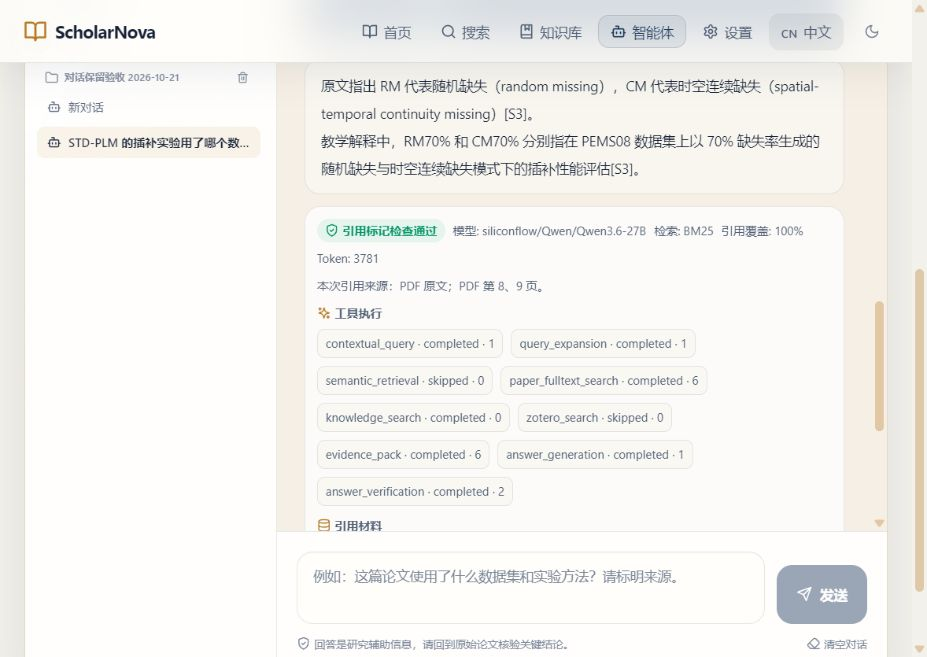

# 对话保留与连续追问调试记录（2026-10-21，main 开发中）

本轮继续处理 10 月 17 日留下的连续使用与历史保留问题。开发源码、隔离资料副本、真实模型回放和桌面试包分别记录，不以某一层通过代替整体业务验收。正式下载和已安装版本仍为 1.2.14；本轮没有覆盖用户的正式资料。

## 1. 对话不再按数量静默删除

移除新建对话时保留 80 个、追加或替换消息时只保留最后 40 条的裁剪。继续使用原来的 v2 工作区存储格式，文件夹、资料分类、范围版本、正文及来源调用记录一起保留。模型请求仍只取当前资料范围最近 6 条消息，未因此扩大模型上下文。

存储配额或写入异常时，业务请求继续运行，新内容保留在内存，磁盘旧记录不被自动清理。页面显示未保存状态，可下载完整对话 JSON 再检查保存；重试本地保存不会重新调用模型。全局关闭/刷新保护不随搜索、知识库或原文伴读的切换而卸载，仍不能防止断电、强制结束进程等情形。

读取、解析或界面所需字段结构异常时，保护原始记录、暂停覆盖。合法的旧 v2 结果允许缺少新增诊断字段，不补出虚假的用量数字；额外原始属性不能替换存储操作方法。旧版单列表迁移不再只取末尾 40 条，核对完整新记录已落盘后才清理旧副本，失败或损坏的原文可随备份带出。

写入前核对最近成功读写的原始记录。另一个窗口已更新时拒绝用旧窗口覆盖，保留双方内容供导出。它是同步存储的版本异动检查，不是数据库原子事务，也不是无限容量或任意多窗口并发保证。旧版已截去的数据不能自动恢复，目前没有备份导入或冲突合并向导。

## 2. 本次真实操作

沿用独立资料副本的“交通流缺失修复与大语言模型 2026-10-17”40 篇分类。没有将测试副本写回正式数据库，没有改动 LLM TWIN 或重新下载模型。

| 操作 | 实际结果 |
| --- | --- |
| 两篇写作对照：STD-PLM 与 SAITS；只要两句观察，不要模板、教学、练习 | Qwen/Qwen3.6-27B 完成，约 10.83 秒，供应商报告 3,061 Token；两句来源观察，教学和练习均为空。实际为 5 个摘要/结论优先页节选，不是两篇全文或期刊规范 |
| 界面询问 STD-PLM 插补数据集，一句并标来源 | Qwen 正确回答 PEMS08，报告 2,622 Token，实际来源含 PDF 第 8 页；未把知识笔记标为原文 |
| 紧接着追问“那 Table 2 中 RM70% 和 CM70% 分别表示什么？只回答两句，区分原文与教学，不要重复上一问的数据集。” | 首次失败：题名上下文没有继承，材料为 0，未调用模型。这条失败回答保留，没有补写 STD-PLM 来冒充原追问已通过 |
| 界面导出对话备份 | 实际下载 JSON，核对当时 1 个文件夹、3 个对话，测试对话全部 4 条消息均在，包含失败回合；不包含模型配置 |
| 重新加载，新建其他对话后返回 | 原问题、回答、失败回合与资料分类保留；新对话不自动携带旧资料分类，不自动发送问题 |
| 冻结后端上，保留失败回合，再次提交完全相同的 Table 2 追问 | Qwen 实际完成，报告 3,781 Token；继承原用户题名，取得 STD-PLM 第 8、9 页，正确解释随机缺失与时空连续缺失。引用标记检查通过；仍提到了上一问的数据集，未完全遵守禁止重复的格式要求，不能记为全部要求通过 |
| 再次重新打开、导出完整连续回合 | 原失败与新成功回答均保留；最终下载文件包含 1 个文件夹、4 个对话，测试对话 6 条消息，没有用新成功覆盖旧失败 |
| 新回答的默认阅读位置 | 原来自动滚到来源卡片底部，正文不在可视区；修复后实际重新打开时，最新正文位于可视区顶部，来源记录仍可向下查看 |

多篇写作对照此前强制附加写作骨架与练习，本轮已把用户输出要求和不可信样本分开，并允许教学/练习为空。仍需核对实际内容，来源编号有效不证明每个观察都正确。

## 3. 连续追问定位问题

原来的省略追问识别覆盖“那是”等表达，遗漏“那 Table 2 中……”这类页表开头问法。没有恢复到指定论文后，原文保护按设计拒答，导致用户感觉前一问刚读过、下一问却失忆。

调试中还发现，表号预选可能只取到表格片段，未带上同一页解释 RM/CM 的普通段落。修复范围限定为用户历史中的论文目标与已定位表格同页的有界上下文；不能因为助手曾提过某篇文章就当成用户选择，也不能在当前分类没有论文时借用其他分类。新明确题名必须优先，未知新题名不得回退旧论文。

表格找到后，同论文、同页补充最多读取 128 个候选片段，后续仍按现有取材与回答预算筛选。本次实际从 7 个候选选了 6 个，不代表读取当前分类的全部 40 篇。原句复验没有增加 STD-PLM 字样，也未删除失败历史。

下图为新界面与本地冻结后端的真实回答，不是原生客户端全流程截图，也不是设计稿。教学解释仍多提了一次数据集，故保留格式未完全通过的结论。

## 4. 验证与剩余事项

| 检查 | 实际结果与范围 |
| --- | --- |
| 最终完整后端 | 1,581 项通过，27 项既有联网测试按原配置未执行，69 条警告保留 |
| 完整前端与后续滚动专项 | 先完整 381 项通过；随后仅调整新回答滚动位置，其所在页面 46 项通过。最终代码的 GitHub CI 再运行完整前端、构建与代码检查并成功，不将两组重叠检查相加 |
| 桌面边界回归 | 66 项通过；包括代理、窗口、进程和访问隔离，不等于本机 Mac 人工实操 |
| 存储异常 | 自动化注入容量不足、读取失败、坏 JSON、缺损调用记录、重复 ID 和跨窗口版本异动；独立审查复放原反例。未故意填满或损坏正式用户存储 |
| 类型、版本与构建 | 类型检查和生产构建通过，各处版本仍为 1.2.14；约 655 kB 主包的既有大包提示保留 |
| Windows 试包 | 本地重新冻结后端并打包独立 QA 目录。最终隐藏窗口、空 profile 的首页/搜索/知识库/智能体/设置五页及许可入口启动检查通过，约 27.47 秒；未替换正式安装目录 |
| 打包后端 | 独立空资料库验证鉴权、无模型时指导状态、知识增改与重启持久化；0 次模型调用。真实原句回放另使用 QA 包中的冻结后端、独立研究资料副本及本地浏览器 |

业务代码提交 `53387fb96d2af2601e10efe8fe3820a47d8e3b0c` 的 [CI](https://github.com/wei9719/ScholarNova/actions/runs/39605870310) 通过；滚动修复提交 `bbe5d09262d11d8939506cb721038cf399e7e8c4` 的[最终代码 CI](https://github.com/wei9719/ScholarNova/actions/runs/39606958931)通过。未创建新版本标签或正式 Release，也未重做 Mac 安装包。

本地 QA 包后端 SHA256 为 `02FEF676E66E53706918984AADFF9B379799C6D6C4D53619D7198EB008C27BEF`，最终前端 `index-DMuQ4Hcd.js` 为 `285221C4E0C572ECF1FE8B2F0DC10D002D55087E0A8754DDFC1A3FF99C5885F0`。这些校验用于区分相同 1.2.14 版号的本地试包与正式旧包，不是新的公开发行承诺。

过程中保留了修复前失败：原句追问没有模型调用；定位专项也先暴露同页定义缺失；并行开发期间一次专项读到新增断言与旧实现的不一致快照而失败，冻结代码后重跑通过。没有删除失败回答或降低引用规则来制造成功。

本轮三个真实模型操作合计报告 9,464 Token，不能当作服务商账单总额。已有数学教学错误不因这次写作或检索修复自动关闭；复杂公式仍未执行符号计算验证。真实学校订阅、正式安装迁移后的全流程回放、备份导入、原生 Office 排版和聊天数据库级并发存储均不是本次完成项。
