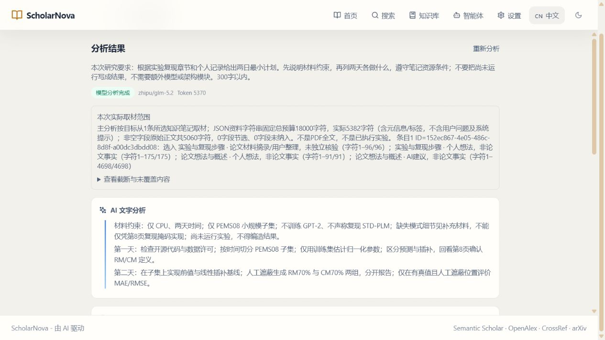

# 研究流程衔接复验记录（main 开发中）

本轮来自用户指出的两类问题：操作链条不顺，以及把测试、打包或发版当成任务结束。本文记录实际做过的操作与尚未验收的部分，不是新的发布公告。已发布和本机安装仍为 **1.2.14**；以下新增功能位于 main 源码和隔离测试环境。

## 1. 本轮采用的同一研究案例

研究问题为道路交通流在大语言模型方法下的缺失修复。沿用已有 40 篇分类中的 STD-PLM，核对本地 PDF 第 8 页 4.1 Datasets 与 Table 2，再保存阅读笔记、询问自己的记录，并安排后续实验。

测试在正式用户资料的独立副本中进行，新分类为“流程验收：交通流插补 2026-10-17”。“两天、CPU、先做简单基线”等内容是测试场景，不代表用户的实际设备条件，更不是已经跑完的实验。没有将测试副本回写正式资料库，没有改动 LLM TWIN，也没有重新发版或替换安装软件。

## 2. 发现的问题与精准修复

| 真实问题 | 本轮处理 | 验证边界 |
| --- | --- | --- |
| 论文把插补写在未来工作中，仍被认为已完成当前插补任务 | 区分当前任务、未来扩展与未知，保留跨域基线而不冒充直接证据 | 只核对实际题名/摘要，不声称核验全文 |
| 明确道路查询把通信网络流量论文列为高度相关 | 对明确道路、通信查询消歧；泛 traffic 不擅自指定领域 | 不修改源查询、来源或请求轮次 |
| 中性“原文信息/教学解释”标题被当成缺引用事实，触发不必要修复 | 仅对纯标题豁免；带数值、断言的句子仍检查引用 | 不降低事实句检查门槛；引用编号有效不等于事实正确 |
| 已存笔记缺少继续研究入口 | 增加继续同篇原文、创建当前资料分类新对话两个显式操作 | 不自动发送，不把聊天文件夹误当证据分类 |
| 从当前分类规划时看到其他方向旧分析 | 分类入口先选材，保留入口状态直到新结果写入缓存 | 不删除上一结果；未分析时刷新也不冒充新结果 |
| 规划只取每条笔记开头 200 字，遗漏后部实验与个人约束 | 在合计 18,000 JSON 字符预算内按目标选择九维分区 | 返回字段与字符范围、截断和遗漏提示，不声称已读全文 |
| 同一伴读回答反复追加，或保存时清空随后新写的个人记录 | 按当前工作区的回答与实际笔记 ID 标记成功保存；仅清理对应已保存输入 | 取消、失败、409 不标成功；不是跨会话全库去重 |
| 全部保存后仍反复弹出离开警告 | 已保存回答不再单独触发；未保存回答和个人输入仍受保护 | 分类改变后保守提示，不移除未保存保护 |
| 用户要简答却强制追加练习，规划按要求回答后又附默认模板 | 用户输出要求独立于论文材料；有规划要求时不发送默认三段模板 | 无额外重试或硬裁句子，默认学习模式仍可提供练习 |
| 正文一提“研究架构图”，后文被隐藏，留下半个标题 | 完整文字与结构图并行，只有闭合控制块不作正文展示 | 保留长文展开，不伪装成模型原文被截断 |
| 缓存结果重新分析时，分类行未加载导致路线标题退回通用名称 | 同一组材料重分析保留先前标题，改选材料不沿用 | 反例回归验证；不猜测或重命名既有路线 |

## 3. 真实模型与检索结果

以下是本轮逐次操作，不是并发负载测试，也不是服务商账单。Token 为响应记录的报告值。

| 实操 | 实际结果 |
| --- | --- |
| 原来完整的 STD-PLM 第 8 页 Table 2 长问题 | Qwen/Qwen3.6-27B 完成，约 18.48 秒，报告 2,753 Token；没有改短原问题才取得这次结果 |
| 单页伴读 | Qwen 完成，报告 2,721 Token；正确区分 PEMS08 插补、RM/CM 均为 70%，教学例子单独标明 |
| 原文伴读整理为九维笔记，再次整理同一回答 | 真实界面保存并更新；该回答正文仍仅出现一次，后部实验约束保留 |
| 基于新笔记生成最小实验计划 | GLM-5.2 完成，约 14.54 秒，主分析及既有结构提炼共报告 4,646 Token；采用 CPU、简单基线、先切分后归一化等后部约束 |
| 新分类问答 | Qwen 完成，约 10.57 秒，报告 1,033 Token；引用新笔记实际 ID，明确实验尚未运行 |
| 修复后新建道路交通流检索 | OpenAlex 与 Crossref 各返回 50 条，约 5.88 秒得到 15 条过匹配下限结果；GATGPT 0.80，STD-PLM/NuwaTS 0.45；三条通信案例不再列在结果中 |
| 审阅计划后保存研究路线 | 通过真实应用 API 保存至隔离资料库，并回读核对完整描述与关联笔记；随后实际界面展开显示完整计划，不冒充点击了界面保存按钮 |
| 保存出口修复后的真实界面复验 | 新 Qwen 回答报告 2,483 Token；成功保存后点击“查看已保存笔记”直接返回原分类，无重复离开警告；分类新空对话、返回同篇原文均实际点击验证 |
| “不要练习”同输入复验 | 原输出强行附加练习的失败保留；修复后 Qwen 报告 2,451 Token，仅核对本页事实，教学与练习均为空 |
| “300 字以内两日计划”同输入复验 | 修复前 GLM 报告 5,895 Token，额外附加默认章节；修复后报告 5,370 Token，实际正文连换行 242 字，保留 CPU/基线/评价条件，没有再追加默认章节 |
| 修复后的界面规划保存 | 进入分类分析后刷新仍保留入口；实际勾选、分析、点击“保存为研究路线”并打开详情，关联同一笔记；没有自动发送或自动保存 |

研究计划仍是待执行计划。实验尚未运行，未下载或执行第三方科研源码，没有生成假实验曲线或提升数字。本次简单检索的默认来源不含 Semantic Scholar，因此不能将它计为新的 Semantic Scholar 限流验收。

下图是本次隔离案例的真实界面，不是设计稿。资料覆盖与模型信息在上方，242 字计划在下方；“CPU、两天”等为测试场景约束。

## 4. 回归检查

- 后端：**1,563 项通过**，27 项既有联网测试按原配置未执行，69 条警告保留。
- 前端：最终完整回归 **334 项通过**，包括缓存重分析标题反例；相关 24 项专项也通过。
- 桌面边界：**66 项通过**。
- 类型检查和生产构建通过；约 645 kB 主包仍有既有大于 500 kB 体积提醒，未将提示隐藏。
- 代码提交 `ff9fd0a` 的 [GitHub CI](https://github.com/wei9719/ScholarNova/actions/runs/39039137821) 已通过，包含 Linux 后端/前端回归、构建、桌面隔离、版本一致性及代码检查；这不是下一版本安装包发布。

测试过程中并非始终全绿：完整后端先出现 11 个旧模拟对象与批量查询结果形状不兼容的失败，补齐模拟字段后重新跑完整套件。分类被 trim、入口刷新丢失、同篇历史重复笔记误标和旧回答标题错配均先用反例复现，再修改实现。没有通过删除原断言或降低引用门槛制造通过。

组件测试会模拟网络、阅读器或表单，不能单独称作端到端业务验收。真实界面、真实 API、单元回归分别记录。

## 5. 尚未关闭的验收项

首次连续界面回放在“查看已保存笔记”的原生离开确认框处受阻，未把这次点击记为通过。修正后从已落盘资料恢复，并重新生成、保存一条真实伴读回答，保存出口和后续规划已实际通过；第一次失败未删除或冒充通过。最后一处缓存重分析标题修复使用反例回归验证，没有为凑界面次数再重复消费同一模型请求。

本轮没有完成重新安装验收、校园身份登录、所有论文数学教学正确性或无限上下文保证。现有聊天存储还有最多 80 个对话、每个对话最多 40 条消息的截断边界，需要进一步改为明确可见的数据保留策略，不能以少量旧对话未改变的回归推断永久完整保留。

本案例的主链已完成源码与隔离资料库实操；后续仍需安装后回放、聊天保留策略和复杂数学质量等专项，再决定下一版本范围。发布流程通过不是这些业务验收的替代。
